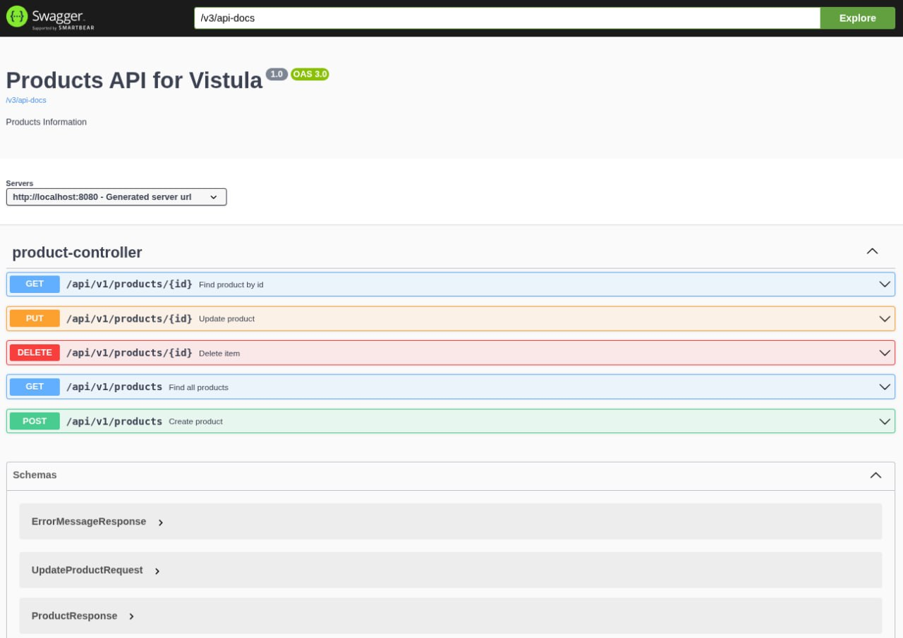
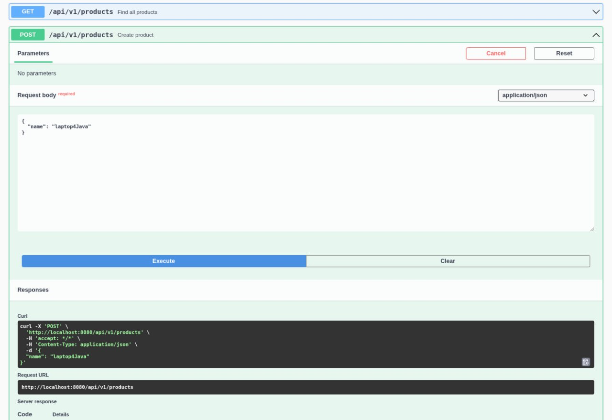
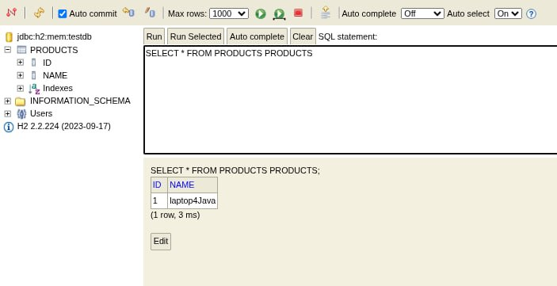

# Project No. 2: Product Management RESTful API

This repository contains the second Spring Framework project developed for the **Packages and Interfaces / Spring Framework** course at **Vistula University**. It is a layered RESTful backend service implementing full CRUD (Create, Read, Update, Delete) operations for product management, backed by an in-memory H2 relational database and documented with OpenAPI/Swagger.

---

## 🛠️ Technologies & Tools Used

* **Java 17** – Core programming language
* **Spring Boot 3** – Core backend framework and embedded Tomcat server
* **Spring Web** – Building RESTful endpoints (`@RestController`, `ResponseEntity`)
* **Spring Data JPA (Hibernate)** – Object-Relational Mapping (ORM) and repository abstraction
* **H2 Database** – In-memory SQL database for runtime persistence
* **Springdoc OpenAPI (Swagger UI)** – Interactive API documentation and endpoint testing
* **Maven** – Dependency management and build tool
* **Git & GitHub** – Version control and repository hosting

---

## 🏗️ Architecture & Features

The application is structured using a clean, multi-layered architecture:

* **API Layer (`api`):** `ProductController` exposes REST endpoints and returns standard HTTP status codes (`200 OK`, `201 Created`, `204 No Content`, `404 Not Found`).
* **Service Layer (`service`):** `ProductService` handles business logic and coordinates data operations.
* **Repository Layer (`repository`):** `ProductRepository` extends `JpaRepository` for database persistence.
* **Domain Layer (`domain`):** `Product` JPA entity mapped to the `PRODUCTS` table.
* **Support & Exception Handling (`support`):**
  * `ProductMapper` maps between Domain entities and Request/Response DTOs.
  * `ProductExceptionAdvisor` (`@ControllerAdvice`) handles `ProductNotFoundException` globally and returns structured JSON error responses (`ErrorMessageResponse`).

---

## 🔌 API Endpoints Overview

| HTTP Method | Endpoint | Description | Success Status |
| :--- | :--- | :--- | :--- |
| **POST** | `/api/v1/products` | Create a new product | `201 Created` |
| **GET** | `/api/v1/products` | Retrieve all products | `200 OK` |
| **GET** | `/api/v1/products/{id}` | Retrieve a single product by ID | `200 OK` |
| **PUT** | `/api/v1/products/{id}` | Update an existing product | `200 OK` |
| **DELETE** | `/api/v1/products/{id}` | Delete a product by ID | `204 No Content` |

---

## 🚀 How to Run & Test

1. **Clone the repository:**
   ```bash
   git clone https://github.com/EmirHAN60/java-project-2.git
   cd java-project-2 
   ```

   Run the Application:

   ./mvnw spring-boot:run

Explore & Test via Swagger UI:
    Navigate to http://localhost:8080/swagger-ui/index.html to test the REST endpoints interactively.

---

## 📸 Application Demonstration

### 1. Swagger UI – Available Endpoints


### 2. Creating a Product (`POST /api/v1/products`)


### 3. Inspecting the Database with H2 Console
Open `http://localhost:8080/console`, connect using JDBC URL `jdbc:h2:mem:testdb` (username: `sa`, empty password), and execute:

    SELECT * FROM PRODUCTS;

